

  

  
  
  
  
  

  

  <b>3+ years</b> of production C firmware at Qualcomm &nbsp;·&nbsp; <b>8+ SoC platforms</b> &nbsp;·&nbsp; <b>16+ features</b> shipped to silicon &nbsp;·&nbsp; <b>30+ P0/P1</b> customer escalations
   
  DSP · Modem · UEFI &nbsp;|&nbsp; timers, watchdog &amp; fault recovery, boot sequencing, heap forensics, on-chip trace

<h2 align="center">🚀 Featured builds</h2>

  <a href="https://github.com/ribhu0908/edu-pci-driver"></a>
  <a href="https://github.com/ribhu0908/gpu-channel-sim"></a>
  <a href="https://github.com/ribhu0908/embedded-c-systems"></a>

  
  
  

| Project | What it proves |
|---|---|
| [**edu-pci-driver**](https://github.com/ribhu0908/edu-pci-driver) | A real Linux kernel module: PCI probe, BAR0 MMIO, MSI with INTx fallback, 28-bit DMA, char device, kref-safe hot-unplug. CI builds a KASAN + lockdep kernel and boots the driver in QEMU: **66/66 checks, clean kernel log** |
| [**gpu-channel-sim**](https://github.com/ribhu0908/gpu-channel-sim) | How a GPU consumes work: GPFIFO channels, pushbuffer methods, semaphore fences, context switching on unmet dependencies, watchdog that isolates and recovers a hung channel. **TSan-clean on Linux and macOS** |
| [**embedded-c-systems**](https://github.com/ribhu0908/embedded-c-systems) | Firmware building blocks: a debug heap that names the owner of a corrupted block, a lock-free ISR-to-task ring buffer, RTOS-style delta-list timers. **ASan/UBSan + Cortex-M4 CI** |

<h2 align="center">⚡ Tech arsenal</h2>

  

  
  
  
  
  
  
  
  

<h2 align="center">🤖 AI developer tooling</h2>

  At Qualcomm I built <b>8 agentic AI developer tools</b> adopted org-wide (log triage, code readiness, debug orchestration);
  a two-level knowledge graph cut LLM debug-token usage by <b>40%</b>.

  

  
  
  
  
  

<b>🗂️ Earlier projects (web and ML, from my M.Tech days)</b>

 

  <a href="https://github.com/ribhu0908/Blog-website"></a>
  <a href="https://github.com/ribhu0908/Customized-ToDoList"></a>
  <a href="https://github.com/ribhu0908/Notes-Keeping-App"></a>
  <a href="https://github.com/ribhu0908/RESTful-API--MyWiki"></a>
  <a href="https://github.com/ribhu0908/FullStack-DevOps-Project"></a>
  <a href="https://github.com/ribhu0908/Text-Classification"></a>

  Outside work I mentor engineers on careers, GATE and interviews &nbsp;·&nbsp;
  <a href="https://topmate.io/ribhu_mukherjee">Topmate</a> &nbsp;·&nbsp;
  <a href="https://www.instagram.com/ribhu_susmita/">Instagram @ribhu_susmita</a>

  

