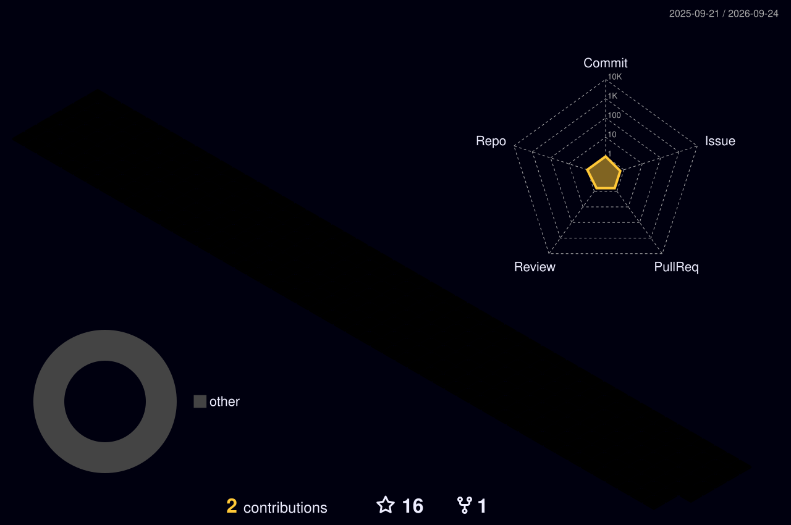

  

  
  
  
  

  

<h2 align="center">⚡ Tech arsenal</h2>

  
    
  

  
  
  
  
  
  

<h2 align="center">🏙️ My contribution city</h2>

  

<h2 align="center">🚀 Featured builds</h2>

  
  
  
  
  
  

<h2 align="center">📊 Stats</h2>

  
  

  

  

